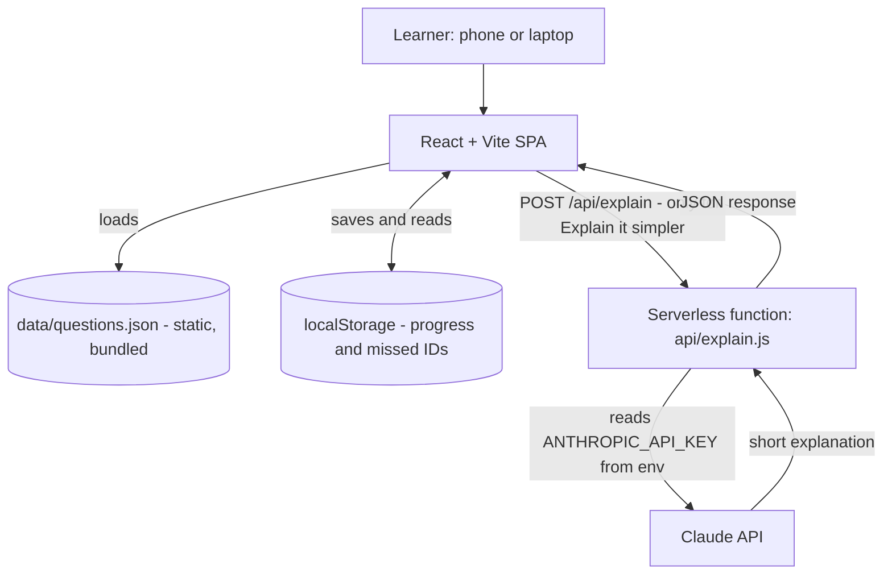

# Smart Quiz Builder for AZ-900

**Pick a topic. Answer. Learn why, instantly.** A mobile-first practice tool for beginners preparing for the Azure Fundamentals exam.

> **Unofficial AZ-900 practice tool. Not affiliated with or endorsed by Microsoft.**

## Live demo

- **App:** [LIVE URL, e.g. https://your-app.vercel.app]
- **Demo video / backup:** [VIDEO OR GIF LINK]

 <!-- [ADD SCREENSHOT] -->
 <!-- [ADD SCREENSHOT] -->
 <!-- [ADD GIF] -->

## Problem and solution

**Problem.** Many learners in Africa start cloud certification on a phone, on limited data, in a second language. Most practice tools only say "right" or "wrong", and "braindump" sites teach memorising instead of understanding.

**Solution.** A small web app that gives instant feedback with a plain explanation of why each answer is right or wrong. It shows results per topic so learners see their weak areas and can retry only what they missed. An optional "Explain it simpler" button uses the Claude API to rephrase an explanation in easier English.

## Features

- Three topics taken from the public AZ-900 skills outline
- Instant feedback: why the correct answer is right and why the others are wrong
- Results per topic and subtopic, with weak areas highlighted
- "Retry missed questions" mode
- Progress saved on the device (localStorage), no account needed
- Works offline after first load (except the AI button)
- "Explain it simpler" (Claude API) with a friendly fallback if it fails
- Designed for 360px-wide phones and low bandwidth

## Architecture



**Data flow**

1. The app loads `questions.json`; `buildQuiz()` filters and shuffles by topic.
2. The learner answers; `checkAnswer()` returns correctness and the explanation.
3. The quiz ends; `calculateScore()` runs and `saveResult()` writes to localStorage.
4. Home and Results screens read `getProgress()` and `getMissedQuestionIds()`.
5. "Explain it simpler" calls `explainSimpler()`, which sends `POST /api/explain`. The function validates the input, calls the Claude API and returns a short explanation. On any failure the UI shows a friendly message and the app keeps working.

**Design choices.** No database and no accounts keep the app fast, cheap and private. The API key exists only on the server. Each module has one job and a fixed function contract.

## Tech stack and tools

| Tool | Purpose | Who used it |
|---|---|---|
| React 18 + Vite (JavaScript) | Single-page app and build | [NAMES] |
| [Plain CSS or Tailwind CSS: CHOOSE ONE] | Styling | [NAME] |
| Vitest | Tests for logic functions | [NAME] |
| ESLint + Prettier | Code quality | [NAMES] |
| Node.js 20 LTS, npm | Runtime and packages | All |
| Claude API (serverless function) | "Explain it simpler" feature | [NAME] |
| Claude.ai | Prompt design, code generation, reviews, drafting | [NAMES] |
| Cursor AI | AI-assisted editing and refactoring | [NAMES] |
| Bolt.new / Lovable.dev | UI scaffolding (optional) | [NAME or "not used"] |
| MGX | UI and design ideas (optional) | [NAME or "not used"] |
| Git + GitHub | Branches, Pull Requests, Issues | All |
| Vercel (primary), Netlify (backup) | Hosting and serverless functions | [NAME] |
| Mermaid | Architecture diagram | [NAME] |
| Canva | Pitch deck | [NAME] |
| curl / Postman | Testing `/api/explain` | [NAMES] |
| Lighthouse | Performance and accessibility checks | [NAME] |
| Loom / OBS / phone recorder | Demo video and GIF | [NAME] |

## Getting started

**Requirements:** Node.js 20 LTS and npm. For the AI feature locally, the [Vercel CLI](https://vercel.com/docs/cli) (`npm i -g vercel`).

```bash
git clone [REPO URL]
cd [REPO FOLDER]
npm install
cp .env.example .env      # then edit .env and add your own key
```

`.env.example` (committed) contains only placeholders:

```
ANTHROPIC_API_KEY=your-key-here
ANTHROPIC_MODEL=[MODEL ID FROM ANTHROPIC DOCS]
```

Never commit `.env`. It is listed in `.gitignore`.

```bash
npm run dev      # UI only. The AI button shows its fallback message.
vercel dev       # UI plus /api/explain, with the AI button working
npm test         # logic tests (Vitest)
npm run build    # production build into dist/
```

<!-- [CONFIRM script names match package.json] -->

## Project structure

```
data/questions.json     Question bank (content lead)
src/components/         React UI (UI developer)
src/logic/              Quiz, scoring, storage, AI client (logic developer)
api/explain.js          Serverless function for the Claude API
docs/                   Diagrams, deployment guide, pitch, prompt log
README.md, vercel.json  Docs lead
.env.example            Environment variable template (no real values)
```

## Content approach

- Every question is **original**. We do not use, recall or imitate real exam or "braindump" questions.
- Topics follow the public AZ-900 skills outline on Microsoft Learn: [LINK TO SKILLS OUTLINE, verify URL].
- Topic names used in the app: "Describe Cloud Concepts", "Describe Azure Architecture and Services", "Describe Azure Management and Governance".
- Each question has a short explanation and a reason each wrong option is wrong.
- Azure facts can change. Learners should confirm details on Microsoft Learn. [OPTIONAL: say who reviewed the content and when.]
- No Microsoft logos or branding are used.

## Prompt Engineering

### Master Prompt (summary)

One shared "Master Prompt" gave every role the same context: product goal, target users, six non-negotiable rules (original questions, disclaimer, exact topic strings, accuracy over creativity, no secrets in code, simple stack), the architecture, the shared data contract, the shared function contract, file ownership and the git workflow. It also fixed the response format (plan first, copy-paste-ready output, one-sentence rationale, closing checklist). Each member then added a role prompt on top.

### Prompts by role

| Role | Prompt goal | Key constraints | Tools used |
|---|---|---|---|
| Content lead | [e.g. Generate original questions per topic and subtopic] | Data contract field names, original questions, exact topic strings, flag uncertain facts | [CONFIRM] |
| UI developer | [e.g. Build mobile-first quiz screens] | 360px, low bandwidth, simple English, disclaimer visible, no Microsoft branding | [CONFIRM] |
| Logic and AI developer | [e.g. Implement the function contract and `/api/explain`] | Exact function names, key only in env vars, validated input, graceful failure | [CONFIRM] |
| Docs, deployment and pitch lead | README, deployment guide, PR checklist, pitch deck | Markdown, placeholders in [BRACKETS], no buzzwords, pitch criteria weights | Claude.ai, Mermaid, Canva |

### The AI feature prompt

System prompt sent by `api/explain.js` (final text: [CONFIRM with logic developer]):

```
You are a patient AZ-900 tutor for beginners whose first language may not be English.
Explain in simple English, in at most 80 words, using short sentences.
Use ONLY the question, options and explanation provided. Do not add new Azure facts,
service names, limits or prices. If the learner chose a wrong answer, say briefly why it
is tempting and why it is not correct. Define any technical word the first time you use it.
End with: "Check the details on Microsoft Learn." Reply in plain text only.
```

**Design notes**

- **Grounded:** the model rewords our reviewed explanation instead of answering from memory, which reduces invented facts.
- **Server-side key:** the browser never sees `ANTHROPIC_API_KEY`.
- **Validated input:** the function accepts POST only, requires 4 options, indexes 0-3 and limited text lengths, and sets a small `max_tokens`.
- **No tools or memory:** the model only returns plain text.
- **Graceful failure:** a timeout or error returns `{ "error": "..." }` and the UI shows a friendly message.
- **Optional by design:** the quiz works without the AI feature.
- **Known limit:** the endpoint is public, so rate limiting is on the roadmap.

### Prompt iteration log

| # | Date | Role | Prompt change | Why | Result |
|---|---|---|---|---|---|
| 1 | 23/10/2026 | All | Master Prompt v1: rules, architecture and contracts in one shared context | Keep the whole team consistent | [RESULT] |
| 2 | [DATE] | [ROLE] | [WHAT CHANGED] | [REASON] | [RESULT] |
| 3 | [DATE] | [ROLE] | [WHAT CHANGED] | [REASON] | [RESULT] |

## Team

| Role | Member | Branch | Owns |
|---|---|---|---|
| Content lead | [NAME] | `feature/question-bank` | `data/questions.json` |
| UI developer | [NAME] | `feature/quiz-ui` | `src/components/`, Vite scaffold |
| Logic and AI developer | [NAME] | `feature/scoring-ai` | `src/logic/`, `api/explain.js` |
| Docs, deployment and pitch | Joshua Mukisa [CONFIRM full name] | `feature/docs-deploy` | `README.md`, `vercel.json`, `docs/` |

## Roadmap and scalability

- **Next:** more questions per subtopic, a review pass by a certified person [OPTIONAL].
- **Learning:** spaced repetition using the stored missed-question IDs.
- **Reach:** local-language explanations, starting with [LANGUAGE].
- **More certifications:** AI-900, AZ-104 and others, reusing the same data contract.
- **Community:** a leaderboard.
- **Accounts:** Supabase for sign-in and cross-device progress (stretch goal, not in the MVP).
- **Scale:** the app is static files plus one function, so hosting cost stays low as users grow. Rate limiting on `/api/explain` comes first.

## Contributing and licence

1. Branch from `main` (`feature/your-change`).
2. Edit only your own area. Commit small, e.g. `feat(logic): add calculateScore`.
3. Run `git pull origin main`, then `npm run build` and `npm test`.
4. Open a Pull Request into `main`.

New questions must be original and follow the data contract.

Licence: [LICENCE, e.g. MIT, confirm with team]. AZ-900 and Azure are trademarks of Microsoft. This project is not affiliated with or endorsed by Microsoft.